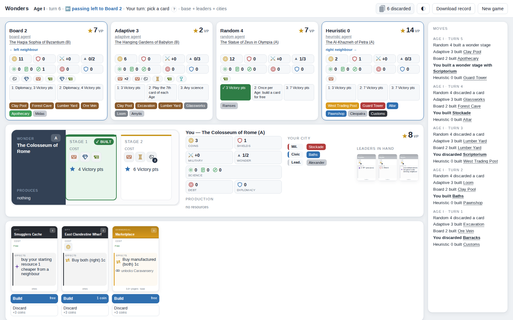
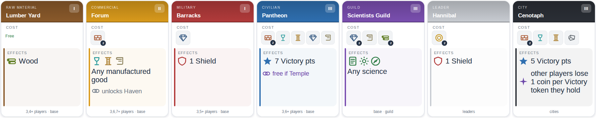
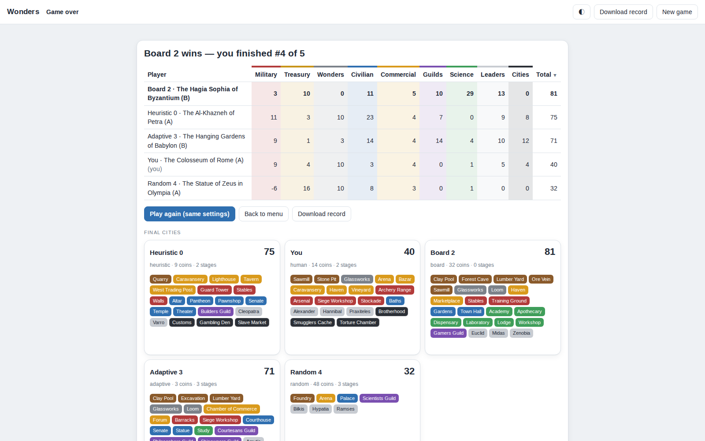

<p align="center">
  
</p>

<h1 align="center">wonders</h1>

<p align="center">
  <b>Can you beat the machine?</b><br>
  Sit down at the table with a trained network in your browser — or build an agent that beats it.<br>
  A complete, rules-checked engine for a 7&nbsp;Wonders-style drafting game, made for players and developers alike.
</p>

<p align="center">
  
  
  
  
  
  
</p>

<p align="center">
  
</p>

> **Disclaimer.** This is an independent, non-commercial fan project. It is not affiliated
> with, endorsed or sponsored by Repos Production or any publisher of *7 Wonders*.
> *7 Wonders* is a trademark of its respective owners. No publisher artwork is included: all
> card and board renderings are generated from game data.

## The challenge

* **Players:** `pip install`, run `wonders gui`, and take on the bundled network. It finishes
  first in 73% of five-player games against the strongest hand-written agents — how often do
  you?
* **Developers:** train or script an agent and put it at the same table:
  `wonders train h2h mine=my_model.pt bundled` (or `wonders bench` for scripted agents).
  Beat the bundled network over a few thousand games and you have the new state of the art for
  this engine — the [training guide](docs/training.md) shows how the current one was made.

## Contents

* [The challenge](#the-challenge)
* [What's inside](#whats-inside)
* [Play in your browser](#play-in-your-browser)
* [Installation](#installation)
* [Command line](#command-line)
* [Python API](#python-api)
* [The bundled network](#the-bundled-network)
* [Documentation](#documentation)
* [License](#license)

## What's inside

### Expansions

| expansion | status | contents |
|---|---|---|
| Base game | ✅ playable | 3–7 players, 68 cards incl. 10 guilds, 7 wonders with A and B sides and every board power |
| Leaders | ✅ playable | 36 leaders with the draft and recruitment phases, 4 extra guilds, the Rome board |
| Cities | ✅ playable | 42 black cards (debt, diplomacy, plunder, …), the Petra and Byzantium boards |
| Armada | 🛠 planned | naval boards, ships and naval conflicts, islands |
| Babel | 🛠 planned | the Tower of Babel and Great Projects |
| Wonder Pack | 🛠 planned | four extra wonder boards |

Expansions combine freely (any subset with the base game). Every power is mechanized and was
checked against the official rulebooks. Plans: [ROADMAP.md](ROADMAP.md).

### Agents

| family | agents | how they play |
|---|---|---|
| Baselines | `random`, `greedy`, `hoarder` | any legal move · most points now · discards for coins |
| Colour archetypes | `militarist`, `scientist`, `civic`, `economist`, `builder` | favour one card colour or the wonder |
| Value functions | `heuristic`, `table`, `balanced`, `opportunist`, `blocker` | tuned scoring of each move; a value table; fill the scarcest colour; switch focus; deny the neighbour |
| Board-aware | `board`, `board-focus` | plan around their own wonder board's needs and powers |
| Adaptive | [`adaptive`](docs/adaptive-agents.md), `rival` | the strongest scripted agents: contest winnable military fronts, adapt to the game phase |
| Learned | `neural`, `neural:<file.pt>` | the bundled network, or your own checkpoint |

17 scripted agents plus any number of networks. Every agent sees only what its seat may legally
see: hidden hands, buried cards and opponents' discards stay hidden.

### Speed

Measured on one core of an Intel i5-12400F unless noted.

| what | throughput |
|---|---|
| complete games, random agents (base game, 4 players) | ~73 games/s |
| complete games, random agents (all expansions, 5 players) | ~37 games/s |
| complete games, `heuristic` agents (base game, 4 players) | ~50 games/s |
| training-env decisions incl. observation encoding (all expansions, 5 players) | ~3,400 decisions/s |
| one decision of the bundled network (CPU) | ~0.4 ms |
| PPO training (6 cores + RTX 3060) | ~1,150 learner steps/s — 10M steps in about 2.5 h |

### And also

* **Replayable game records** — like PGN for chess: every game can be saved, shared and replayed
  move by move (`wonders play --record`, `wonders replay`, the GUI's download button).
* **Training environments** — a fixed discrete action space with legal-action masks, a
  PettingZoo-style multi-agent env, a Gym-style single-agent env and multi-process vector envs,
  without depending on Gym or PettingZoo.
* **Evaluation tools** — benchmarks with 95% confidence intervals, head-to-head comparison of
  models at the same tables, exploitability measurement.
* **Light** — the core is pure Python with `click` as its only runtime dependency; PyTorch is
  only needed for the learned agent. Type-checked with mypy and covered by ~300 tests.

## Play in your browser

```
wonders gui
```

Pick the expansions, an opponent for every seat and your wonder, then play. Cards and boards are
rendered from the game data, build costs include trade — and you choose which neighbour to buy
from —, every city shows its stats, resources and wonder stages, and hovering anything explains
it. The final score sheet is colour-coded and sortable, and the game record can be downloaded at
any time. Everything runs locally.

**Analyse my moves.** After the game, the network-guided search reviews every one of your moves —
judged only with what you could see at the time — and shows your accuracy, the expected margin over
the game, and your key moments: what you played, what was better, how many points it cost and why
(e.g. *"gains 4.8 science"*) — each replayed from the real position to show how the game would have
gone. It also spots patterns: coins spent on trade, conflicts lost by one shield, the science symbol
you were missing, strong cards you passed to a neighbour.

<p align="center">
  
</p>
<p align="center">
  
</p>

## Installation

```
pip install "git+https://github.com/godaup/wonders"            # core
pip install "wonders[ml] @ git+https://github.com/godaup/wonders"  # + the learned agent (PyTorch)
```

For development (Python 3.10+):

```
git clone https://github.com/godaup/wonders && cd wonders
python -m venv .venv && source .venv/bin/activate
pip install -e ".[test,dev]"      # add ml for the learned agent
make test                         # format, lint (flake8 + mypy) and the test suite
```

For training on an NVIDIA GPU install the matching PyTorch wheel first, e.g.
`pip install torch --index-url https://download.pytorch.org/whl/cu128`.

## Command line

```
wonders play -a heuristic,greedy,random --record game.json   # one game: transcript and scores
wonders play -e base -e leaders -e cities -a neural,adaptive,board,heuristic
wonders replay game.json                                      # re-simulate a record
wonders analyse game.json --seat 0 -p 4                       # rate one player's moves (needs PyTorch)
wonders bench -a adaptive,board,heuristic -n 500 -p 4         # win rates with 95% CIs
wonders agents                                                # the built-in agents
wonders gui                                                   # play against agents in your browser
wonders gallery -o cards.html                                 # every card and wonder board as HTML
wonders table -o table.html                                   # render the final table of a demo game
```

`-e` lists the expansions in play (include `base`); `-a` takes one agent per seat — a built-in
name, `neural` for the bundled network, or `neural:<checkpoint.pt>`.

`wonders gui --checkpoint model.pt` adds your own network as an opponent in the browser table.

### Training (needs PyTorch)

The [training guide](docs/training.md) explains the full workflow; the main commands:

```
wonders train imitate -n 3000 -p 6 -o imitation.pt         # behaviour cloning of a scripted agent
wonders train ppo --init imitation.pt -n 150 -o ppo.pt     # PPO against built-in opponents
wonders train sweep sweeps/stage3.json -p 6                # a full recipe from a JSON spec (resumable)
wonders train eval ppo.pt                                  # vs scripted lineups, per expansion and player count
wonders train h2h a=one.pt b=other.pt -p 6                 # models at the same tables (random seating)
wonders train exploit e=exploiter.pt t=target.pt           # one model at tables full of copies of another
wonders train leaders ppo.pt                               # Leaders diagnostics (teacher agreement, ablations)
```

## Python API

```python
import random
from wonders.agents import GreedyAgent, HeuristicAgent
from wonders.env import SingleAgentEnv

env = SingleAgentEnv([HeuristicAgent(), GreedyAgent()], learner=0, reward='margin')
obs, info = env.reset(seed=0)
done = False
while not done:
    legal = [i for i, ok in enumerate(obs['action_mask']) if ok]
    obs, reward, done, truncated, info = env.step(random.choice(legal))  # your policy here
print(info['scores'])
```

For throughput, batch games across processes with `wonders.env.SubprocVectorEnv` and a
`SingleAgentEnvFactory`. Agents implement `decide(observation) -> action` (see
`wonders/agents/base.py`); the observation and action space are documented in
`wonders/engine/observation.py` and `wonders/env/`.

## The bundled network

`wonders/ml/pretrained/ppo_universal_v2.pt` (the `neural` agent) plays **every expansion
combination with 3–7 players**. It is a 256×2 policy/value network over the `table-v2` observation
encoder: first cloned from the `adaptive` agent, then trained for 50M PPO steps in self-play
against a mix of scripted agents, its own recent snapshots and the best earlier models, and
finally fine-tuned for 10M steps under the current rules — see the
[training guide](docs/training.md).

**How strong is it?** 4,000 games, every expansion combination and 3–7 players, with
the network, the two strongest scripted agents and `heuristic` agents filling the remaining seats
(seats drawn at random every game):

| at the same table | finishes first | ranked above the other | mean score |
|---|---|---|---|
| **bundled network** (`neural`) | **76%** | above `adaptive` in **87%**, above `board` in **88%** of games | 71.1 |
| [`adaptive`](docs/adaptive-agents.md) | 10% | above `board` in 53% | 57.4 |
| `board` | 9% | | 56.1 |
| *an even share* | *22%* | *50%* | |

The network averages +13.8 points over `adaptive` and wins about 3.5× as often as an even share.

By player count (all expansions), the network's share of first places compared with an even
share:

| players | 3 | 4 | 5 | 6 | 7 |
|---|---|---|---|---|---|
| bundled network | **88%** | **81%** | **73%** | **71%** | **68%** |
| even share | 33% | 25% | 20% | 17% | 14% |

* [`adaptive`](docs/adaptive-agents.md) — the strongest scripted agent: plans around its wonder
  board, contests the military fronts it can win, and adapts to the game phase and to what its
  neighbours collect.
* `board` — plans production for its wonder stages and values its board's powers.
* `heuristic` — a tuned value function over points, science sets, military, economy and chains.

These numbers were measured under the current rules, which the network was trained under too.

## Documentation

* [Training guide](docs/training.md) — train, evaluate and compare your own agents.
* [Roadmap](ROADMAP.md) — planned work: stronger networks (retraining, search, expert iteration),
  new ways to play and learn (browser version, difficulty levels, puzzles, post-game analysis,
  translations, accessibility), expansions and extensions, and research benchmarks.
* [Changelog](CHANGELOG.md) — what changed.
* [Contributing](CONTRIBUTING.md) — how to contribute.
* [Architecture overview](CLAUDE.md) — the code structure, written for AI coding assistants and
  useful for human contributors too.

## License

MIT — see [LICENSE](LICENSE). The disclaimer above applies.
